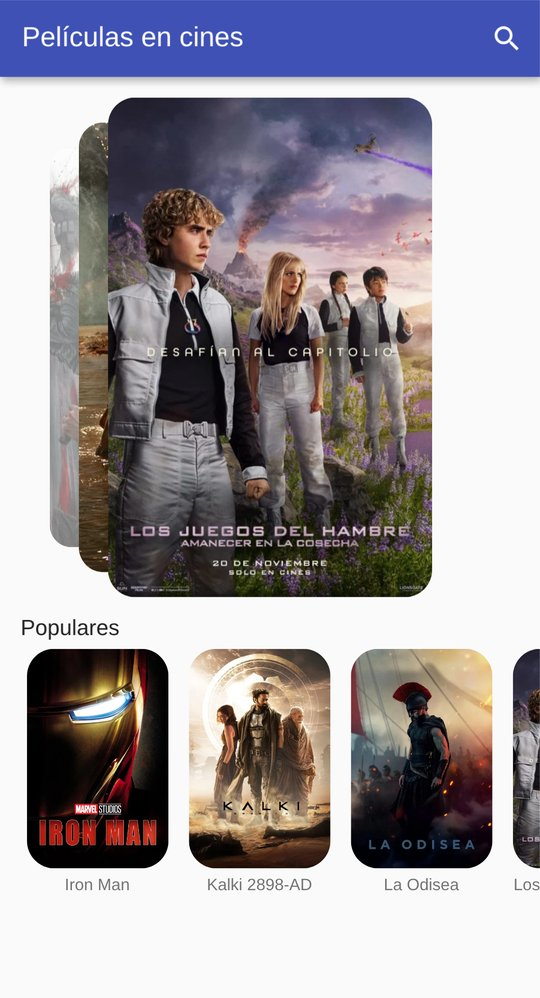
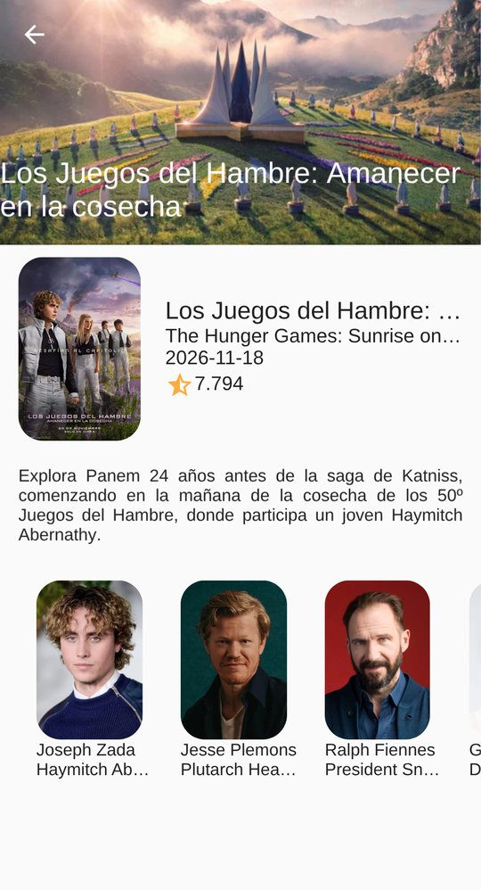
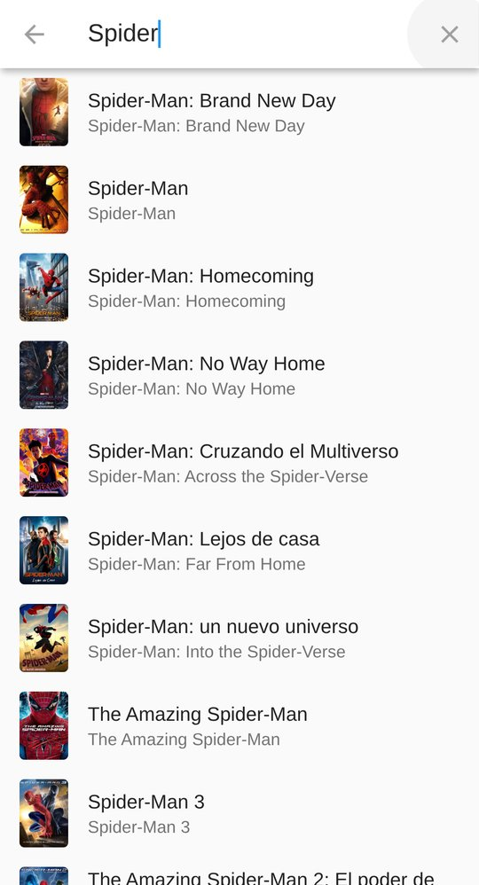

# Películas App

A Flutter movie browser built on [The Movie Database (TMDB)](https://www.themoviedb.org/) API. It lists movies now in theaters and popular titles, and shows details and cast for each one. The UI is in Spanish (`es-ES`).

<p align="center">
  
  &nbsp;
  
  &nbsp;
  
</p>

## Features

- **Now playing**: a card swiper of movies currently in theaters.
- **Popular**: a horizontal list that loads more pages as you scroll (infinite scroll with a `Stream`).
- **Movie detail**: a collapsing `SliverAppBar` backdrop, poster with a `Hero` animation, original title, release date, rating, overview and cast.
- **Search**: a `SearchDelegate` that queries TMDB as you type.

## Tech

- Flutter 2.x with sound null safety (Dart `>=2.12 <3.0`)
- [`http`](https://pub.dev/packages/http) for the TMDB REST calls
- [`flutter_card_swipper`](https://pub.dev/packages/flutter_card_swipper) for the now-playing carousel

## Project structure

```
lib/
├── main.dart
└── src/
    ├── models/      # Pelicula and Actor models (JSON parsing)
    ├── pages/       # HomePage, PeliculaDetallePage
    ├── providers/   # PeliculasProvider: TMDB API calls
    ├── routes/      # Named routes
    ├── search/      # DataSearch (SearchDelegate)
    └── widgets/     # Card swiper and horizontal list
```

## Getting started

1. Install a Flutter 2.x SDK (the project was last tested with **2.10.5**; Dart 3 / Flutter 3.10+ won't resolve the SDK constraint).
2. Get a free TMDB API key at <https://www.themoviedb.org/settings/api> and set it in `lib/src/providers/peliculas_provider.dart` (`_apiKey`).
3. Run it:

   ```bash
   flutter pub get
   flutter run            # Android / iOS device or emulator
   flutter run -d chrome  # or in the browser
   ```

## Notes

`home_page.dart`: `SafeArea` keeps content clear of devices that have a notch at the top.

---

This product uses the TMDB API but is not endorsed or certified by TMDB.
